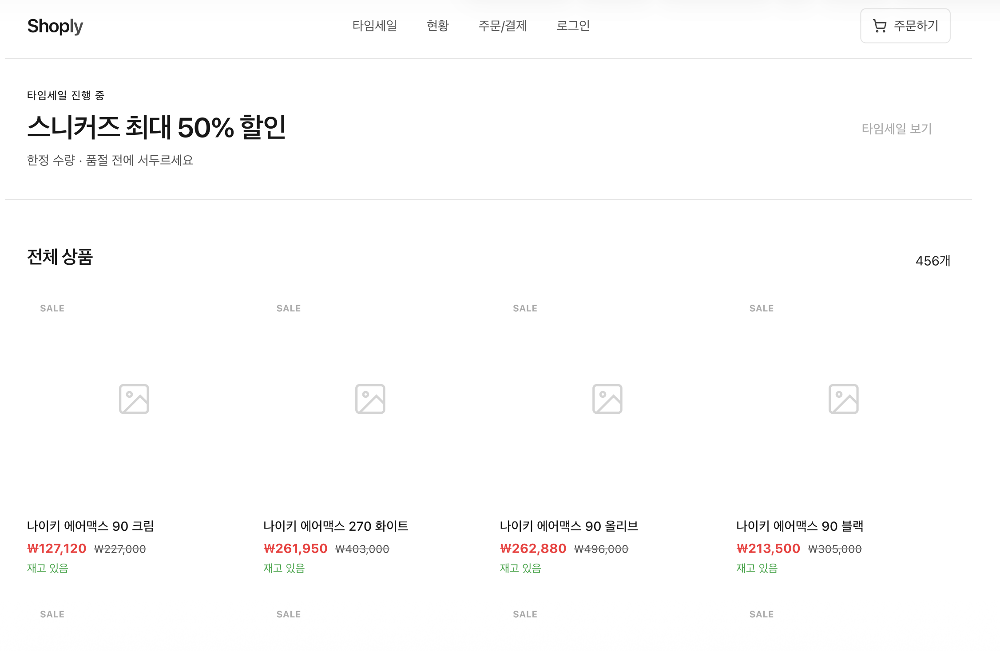
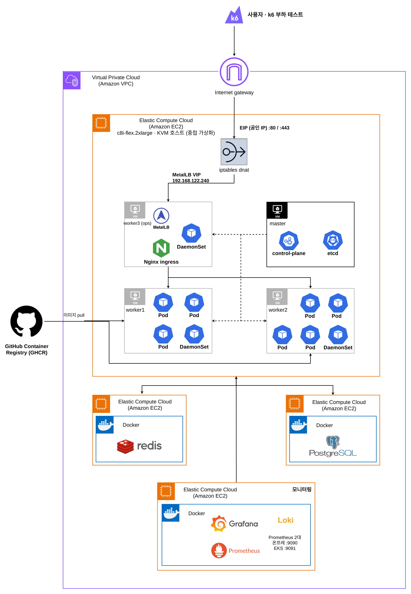
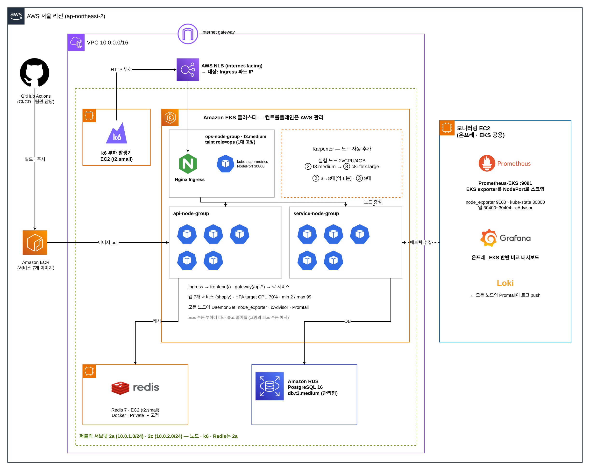
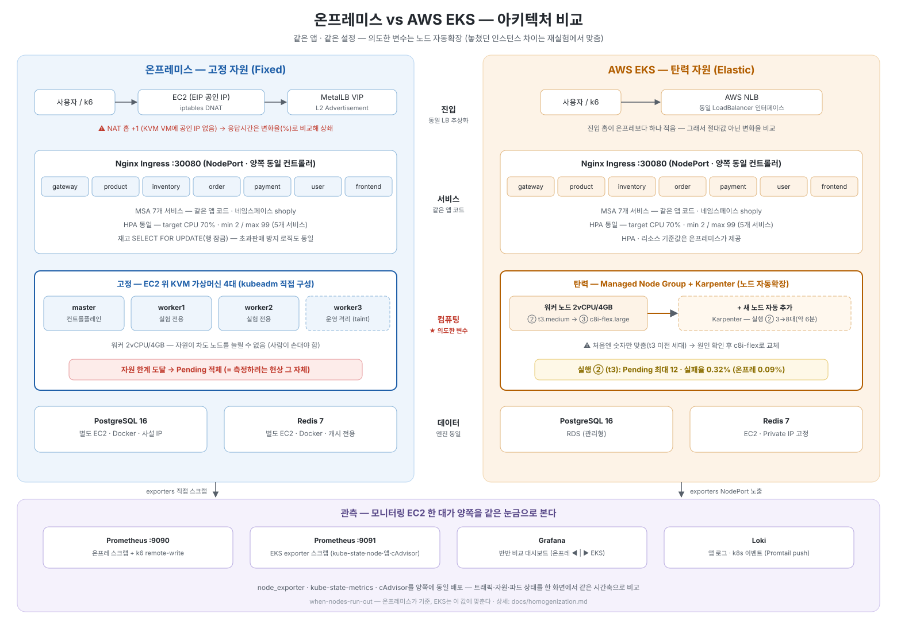
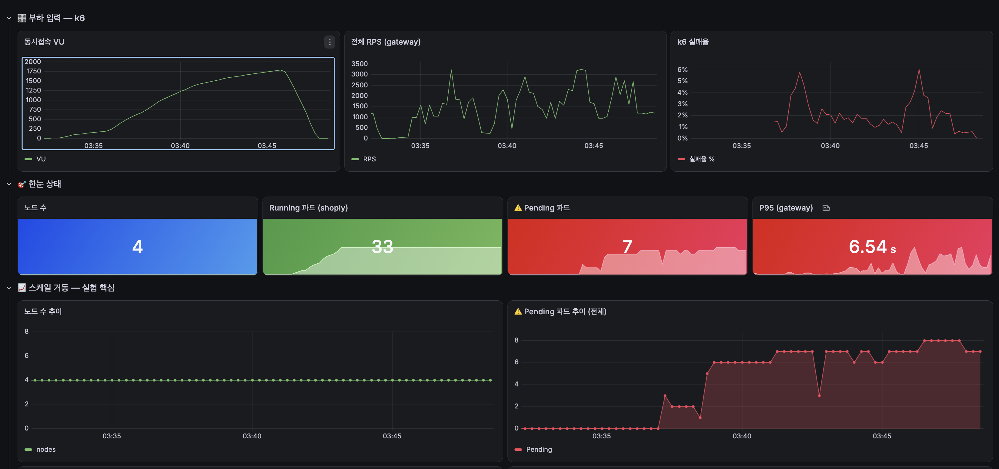
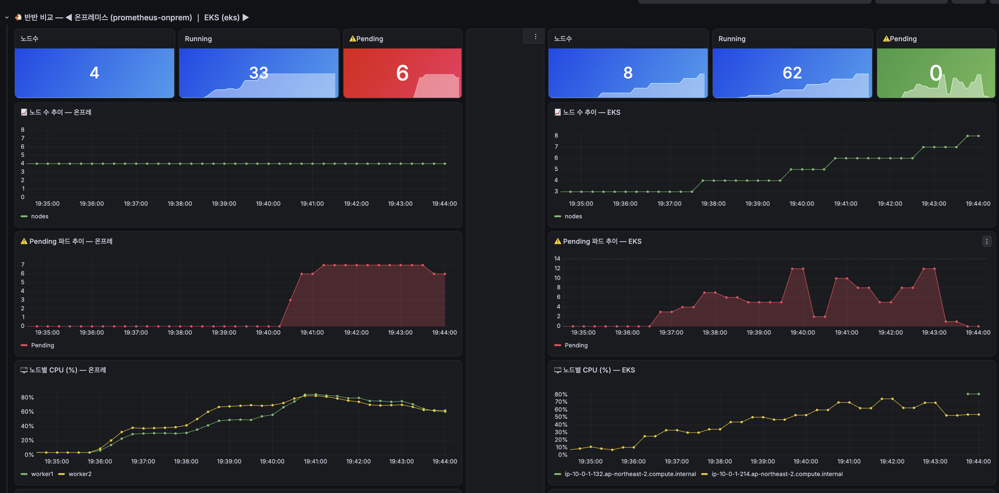

# when-nodes-run-out

> 동일한 앱, 동일한 트래픽, 다른 인프라 — 데이터가 말하게 한다.

**"클라우드는 트래픽 폭증에 강하다"는 통념, 진짜일까?** 이커머스 타임세일처럼 트래픽이 순간 폭증하는 상황을 가정하고, 동일한 쇼핑몰 MSA 앱을 **온프레미스 Kubernetes(노드 고정)** 와 **AWS EKS(Karpenter 노드 자동확장)** 에 똑같이 배포했습니다. **"노드 자동확장 유무" 하나만 변수로 남기는 것**을 목표로 부하를 걸어 데이터로 비교한 실험 프로젝트입니다.

온프레미스에서 Pending 파드가 쌓이는 것은 실패가 아니라 **측정하려는 현상 그 자체**입니다.



## 한눈에 보기

| 항목 | 내용 |
|---|---|
| 기간 · 인원 | 2026.04 ~ 2026.07 · 4명 (온프레미스 팀 / EKS 팀) |
| 내 역할 | **온프레미스 사이드 전체** — MSA 앱 개발, EC2 위 KVM 클러스터 구축, 배포, 모니터링 구축, 실험 관측 · 결과 정리 (부하 테스트 실행은 팀원) |
| 결과 | ① 고정 자원이 무너지는 지점을 숫자로 관측 → ② 첫 비교에서 **기대와 다른 결과** → ③ 원인(인스턴스 차이)을 찾아 **장비를 바꿔 재실험** → 종료 후 **복기**로 원인 재정리 |
| 기록 | 장애 20건 트러블슈팅 · 깊은 회고 3건 · 실험 영상 68초 |

## 1. 구성

### 온프레미스 — EC2 위에 KVM으로 물리 클러스터 재현



- **호스트**: c8i-flex.2xlarge 스팟 EC2에서 중첩 가상화로 KVM VM 4대(master · worker1·2 실험용 · worker3 운영 격리)를 띄우고 kubeadm으로 직접 구성
- **진입**: EIP → 호스트 iptables DNAT → MetalLB VIP → Nginx Ingress
- **데이터 · 관측**: PostgreSQL 16 · Redis는 별도 EC2, Prometheus · Grafana · Loki는 모니터링 EC2 한 대에서 온프레·EKS를 함께 수집

### AWS EKS — 비교 대상 (팀원 구축)



NLB → Nginx Ingress(ops 노드) → api · service 노드그룹, Karpenter 노드 자동확장, RDS PostgreSQL 16 · Redis EC2. 실험 노드는 첫 비교(실행 ②) 때 t3.medium, 재실험(실행 ③)에서 c8i-flex.large였습니다.

### 두 환경 비교 — 무엇을 같게, 무엇을 다르게



앱 이미지 · 매니페스트 · HPA · DB 엔진은 같게, 노드 자동확장만 다르게 두는 것이 설계였습니다. 통제변수 전체는 [`docs/homogenization.md`](docs/homogenization.md), 트래픽 경로와 포트는 [`docs/architecture.md`](docs/architecture.md)에 있습니다.

## 2. 실험과 결과

부하는 계단식으로 올리고 단계마다 유지해, HPA와 노드 증설이 반응할 시간을 주면서 변화를 관찰했습니다. 상세 수치와 해석은 [`docs/experiments.md`](docs/experiments.md)에 있습니다.

### 실행 ① 온프레미스 한계 탐색 — 고정 자원이 무너지는 지점

노드 4개 고정 상태에서 동시접속을 계단식으로 올리자(최대 2000 VU 설계, 실제 도달 약 1,800 VU) Running 파드가 33개까지 늘어난 뒤 **Pending 0→7개, P95 6.54초, 실패율 최대 6%** 로 무너지는 지점을 포착했습니다.



### 실행 ② 온프레미스 vs EKS — 기대와 다른 결과

양쪽 Prometheus를 하나의 Grafana에 붙인 반반 비교 대시보드로 같은 부하(100→200→300 VU)를 관측했습니다.

| 항목 | 온프레미스 | EKS (t3.medium) |
|---|---|---|
| 노드 | 4개 고정 | 3 → 8개 (약 6분) |
| Running 파드 | 33 | 62 |
| Pending | 6~7개가 내려가지 않음 | 최대 12개까지 쌓였다가 해소 |
| k6 실패율 | 0.09% | **0.32%** |

EKS는 노드를 늘려 더 많은 파드를 받아냈지만, 노드가 붙기 전까지 Pending이 쌓였고 실패율은 오히려 온프레보다 높았습니다. "탄력 자원은 흔들림 없이 버틴다"는 기대와 달랐습니다.



→ 300 VU 전 과정 [68초 실황 영상](docs/videos/run2-compare-300vu.mp4)

### 원인 — 숫자만 같고 장비가 달랐다

노드 1대를 2vCPU/4GB로 맞췄지만 **EKS는 t3.medium(Skylake/Cascade Lake 세대), 온프레는 c8i-flex(Intel Xeon 6)** 위에서 돌았습니다. 같은 2vCPU라도 세대 차이만큼 vCPU 하나가 처리하는 양이 달랐고, 인스턴스 세대를 통제 변수로 보지 못한 것이 가장 큰 원인이었고, 노드 증설 지연(약 6분)과 데몬셋 리소스 차이도 함께 작용했습니다.

### 실행 ③ 장비를 바꿔 재실험

첫 발표 뒤 EKS 실험 노드를 **c8i-flex.large로 바꿔 온프레와 다시 돌렸고**, 최종 발표에서는 "고정 자원은 무너지고, 탄력 자원은 버텼다"로 정리했습니다.

### 복기

프로젝트가 끝난 뒤 실험 결과와 근거 자료를 처음부터 다시 확인한 내용은 [`docs/retrospective.md`](docs/retrospective.md)에 따로 정리했습니다.

## 3. 내 역할 — 앱부터 관측까지 온프레미스 전 과정

4명 팀에서 **온프레미스 사이드 전체**를 담당했습니다.

```
[앱 개발]       MSA 7개 서비스 코드·Dockerfile 작성 (이미지 빌드·푸시 CI/CD는 팀원)  → app/
[온프레 인프라]  EC2 → KVM VM 4대 → kubeadm 클러스터 → 네트워크      → onprem/
[서비스 배포]   매니페스트(Deploy/HPA/Ingress) 작성 → 배포 → 검증     → onprem/k8s/
[모니터링]      Prometheus/Grafana/Loki 구축 → 비교 대시보드          → monitoring/
[실험]          기본 k6 스크립트로 동작 확인 → (부하 실행은 팀원) → 대시보드 관측 → 결과 정리·복기  → k6/ · docs/
```

| 폴더 | 담당 | 내용 |
|---|---|---|
| `app/` `onprem/` `monitoring/` `postgres/` `redis/` `userdata/` `docs/` | **본인** | 위 흐름 전체 — 이 프로젝트의 핵심 |
| `k6/` | 본인 · 팀원 | 기본 스크립트는 본인, 부하 테스트 설계·실행은 팀원 |
| `team/` | 팀원 | EKS 인프라(Terraform)·EKS 서비스 배포·부하 테스트·CI/CD 운영 — **비교 참고용** |

팀 구성과 역할 경계의 상세: [`docs/project-roles.md`](docs/project-roles.md)

## 4. 장애 사례와 해결

클러스터를 수차례 재구축하며 겪은 **장애 20건을 전부 기록**했고([`onprem/TROUBLESHOOTING.md`](onprem/TROUBLESHOOTING.md)), 그중 진단 과정에 이야기가 있는 3건은 `증상 → 로그 → 원인 → 왜 그렇게 판단했는가 → 해결 → 재발 방지`로 깊게 회고했습니다.

| 장애 | 진단의 핵심 |
|---|---|
| [flannel 전멸 — br_netfilter 미로드](docs/incidents/01-flannel-br-netfilter.md) | 에러 두 개 중 원인과 결과를 나눠 커널 모듈까지 내려감 |
| [외부 접속 불가 — DNAT 누락/불일치](docs/incidents/02-dnat-external-access.md) | curl이 실패하는 모양으로 패킷이 어디까지 갔는지 판단 + 광역 DNAT가 만든 2차 장애 |
| [모니터링 타겟 다운](docs/incidents/03-monitoring-targets-down.md) | 살아 있는 타겟과 죽은 타겟의 차이로 고장 난 구간을 특정 |

## 5. 배운 점

- **"변수 하나만 남기는" 통제는 생각보다 훨씬 어렵다.** 최대한 비슷하게 설계했다고 믿었지만 vCPU·메모리 숫자만 맞췄을 뿐 인스턴스 세대(온프레 c8i-flex vs EKS t3.medium)는 생각하지 못했고, 이게 첫 비교가 기대와 다르게 나온 가장 큰 이유였다. 원인을 찾은 뒤 장비를 바꿔 다시 돌렸다. 또 서비스 파드 리소스는 맞췄어도 데몬셋·모니터링 파드의 리소스까지는 통제하지 못했다. 실험 설계는 세부까지 신중해야 한다는 걸 결과로 배웠다.
- **서버 하나를 "운영"하는 일의 무게를 알게 됐다.** VM을 만들어 돌리는 것 자체가 쉽지 않았고, 켜두는 것만으로 비용이 나간다. 비싼 인스턴스를 스팟으로 돌리고, 비용 부담에 매번 끄고 켜며 클러스터를 처음부터 다시 세워야 했다.
- **반복이 문서를 만들고, 문서가 속도를 만든다.** 가장 오래 막힌 건 KVM 구축이었다. 처음엔 설치·세팅·연결 하나하나가 전부 오래 걸렸지만, 절차를 문서로 고정하고 나중엔 AMI 이미지로 구워두니 재구축 시간이 크게 단축됐다. 여러 번 다시 세우다 보니 전에 겪은 오류가 또 나와도 대처가 빨라졌다 — 트러블슈팅 20건을 기록한 이유이기도 하다.
- **두 팀 사이의 소통이 실험 품질을 결정한다.** 온프레 팀과 EKS 팀으로 나뉘어 진행하다 보니 서로 소통하기가 어려웠고, 동일화가 완벽하지 못해 결과가 살짝 아쉬웠다. 다시 한다면 EKS가 제공하는 걸 더 깊게 활용하고, 배포 전에 리소스값 하나하나까지 양쪽을 맞춰서 제대로 실험해보고 싶다.

이 경험 전체가 클라우드 엔지니어라는 목표로 이어진다 — 여기서 배우고 부딪힌 것들을 실무에서 그대로 써먹어보고 싶다.

## 6. 사용 기술

| 영역 | 스택 |
|---|---|
| 앱 | Node.js 22 · Express · TypeScript · React 19 |
| 온프레 인프라 | Kubernetes(kubeadm) · KVM/libvirt · Docker · AWS EC2(스팟, 중첩 가상화) |
| 네트워크 | Flannel · MetalLB · Nginx Ingress · iptables DNAT |
| 데이터 | PostgreSQL 16 · Redis 7 |
| 관측 | Prometheus · Grafana · Loki |
| 부하·CI/CD | k6 · GitHub Actions → GHCR |
| EKS 쪽 (팀원) | Terraform · EKS · Karpenter · NLB · RDS |

## 7. 저장소 안내

```
├── app/          # MSA 7개 서비스 + React 프론트 (코드·설계 결정·CI/CD)
├── onprem/       # KVM·kubeadm 클러스터 구축, 매니페스트, 트러블슈팅 20건, 백업/복원, 원본 실행 문서(runbook/)
├── monitoring/   # Prometheus·Grafana·Loki 구성, 온프레-EKS 비교 대시보드
├── k6/           # 부하 시나리오 2종 + 실행 결과
├── postgres/ redis/ userdata/   # 온프레용 DB·캐시, EC2 부트스트랩
├── docs/         # 문서 허브 — 실험·아키텍처·장애 회고 (docs/README.md부터)
└── team/         # ⚠️ 팀원 작성 파트 (EKS 인프라·배포·CI/CD) — 비교 참고용
```

| 무엇이 궁금한가 | 읽을 문서 |
|---|---|
| 실험 설계 · 결과 | [`docs/experiments.md`](docs/experiments.md) |
| 프로젝트 종료 후 복기 | [`docs/retrospective.md`](docs/retrospective.md) |
| 공정 비교를 위한 통제변수 | [`docs/homogenization.md`](docs/homogenization.md) |
| 트래픽 경로 · 작업 흐름 · 포트 | [`docs/architecture.md`](docs/architecture.md) |
| 온프레 클러스터를 어떻게 세웠나 | [`onprem/README.md`](onprem/README.md) · 단계별 원본 [`onprem/runbook/`](onprem/runbook/) |
| 모니터링 구성 · 대시보드 | [`monitoring/README.md`](monitoring/README.md) |
| 앱 구조 · 설계 결정 | [`app/README.md`](app/README.md) |

| 브랜치 | 용도 |
|---|---|
| `main` | 완성본 (지금 보고 있는 것) |
| `app` / `onprem` / `shared` | 컴포넌트별 작업 이력 아카이브 |
| `develop` | 컴포넌트 브랜치 통합·검증 이력 |

> ⚠️ `team/` 하위(EKS 인프라 Terraform, EKS 서비스 배포, CI/CD 운영)는 **팀원이 작성**했습니다. 본인 성과가 아니며, 비교·참고를 위해 원문 그대로 보관합니다 — 각 폴더 README 상단에도 동일하게 표기해뒀습니다.
