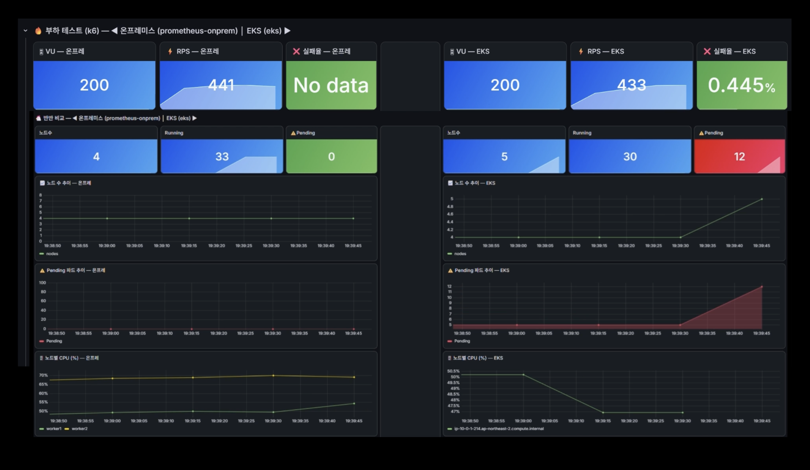
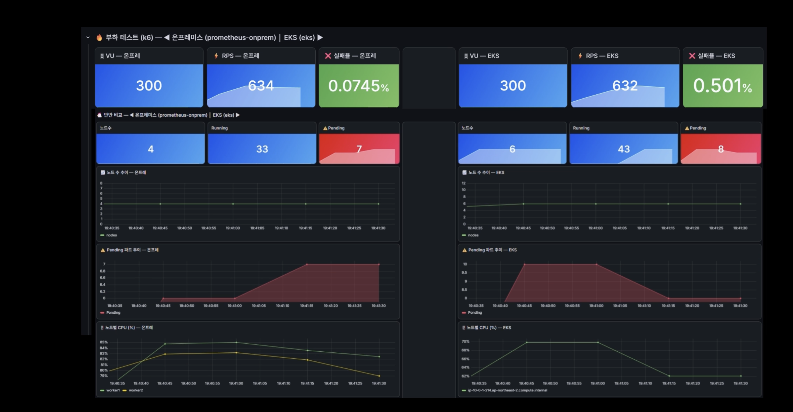

# 실험 — 안정 상태부터 한계까지, 점진 부하로 관찰하기

## 실험 프레임

> 이 문서의 실행 ①·②는 본인이 작성한 [`k6/`](../k6/) 스크립트로 직접 돌린 결과입니다. 실행 ③(재실험)의 EKS 수치는 팀원 기록을 인용했습니다. 팀 공식 3종 시나리오(안정·스파이크·노드장애)는 팀원이 설계했으며 [`team/cicd-k6/`](../team/cicd-k6/)에 있습니다.

앱·부하·설정을 전부 동일하게 맞추고, 딱 하나만 다르게 둡니다.

| 항목 | 온프레미스 | EKS |
|---|---|---|
| 파드 자동확장(HPA) | ✅ 동일 | ✅ 동일 |
| **노드 자동확장** ★핵심 | ❌ 없음(고정) | ✅ Karpenter |

핵심 독립변수는 "노드 자동확장"입니다. 온프레미스에서 Pending이 쌓이는 것은 실패가 아니라 측정 대상입니다.

## 공통 조건 (양쪽 동일하게 맞추려 한 것)

| 항목 | 값 |
|---|---|
| 이미지 | 같은 앱 코드 — 단, 실제 배포 태그는 온프레 `:latest` / EKS `:otel`로 달랐음([복기](#복기--첫-비교는-왜-기대와-다르게-나왔나) 2번) |
| 부하 도구 | k6(동일 스크립트) — [`../k6/README.md`](../k6/README.md) |
| 리소스 | request 100m/limit 500m, HPA target 70% · min 2 · max 99 (초기 동작 확인 땐 기본값 max 10 — [동일화 문서](homogenization.md) 참고) |
| 데이터 | 상품 20\~456종, 계정 test1\~2000(`Test1234!`) |
| 실험 전 | `load-test-prep.sql`로 DB 리셋(재고 사전 세팅으로 실험 오염 방지) |

부하 방식은 하이브리드입니다: request를 작게(100m) 둬서 HPA가 민감하게 발동하게 하고, k6 동시접속(VU)을 크게 줘서 실제 CPU를 올립니다.

## 실험 방법 — 왜 점진(계단식) 부하인가

순간 스파이크로 때리면 시스템이 반응하기 전에 끝나 아무것도 안 보입니다. HPA가 파드를 늘리는 데 수십 초, Karpenter가 새 노드를 띄우는 데도 보통 1분 안팎이 걸리므로, **부하를 계단식으로 올리고 각 단계를 유지하면서** 시스템이 반응할 시간을 주고, 단계마다 무엇이 달라지는지를 관찰하는 방식을 택했습니다.

각 단계에서 관찰하는 전개는 이렇습니다:

```
안정 구간        →  HPA 반응        →  자원 포화           →  한계 (온프레) / 회복 (EKS)
Pending 0          파드 증설 시작       워커 CPU 80~90%       Pending 적체·P95 급등 / 노드 증설
에러 0%            replicas ↑          레이턴시 상승 시작      실패율 상승 / 해소
```

측정 지표: 노드 수 · Running/Pending 파드 수 · HPA replicas · 워커 CPU · P95 레이턴시 · k6 실패율. 전 과정을 Grafana에서 실시간 관찰하며 단계 전환점마다 캡처했습니다.

## 실행 ① — 온프레미스 한계 탐색 (최대 2000 VU 설계, 계단식)

`scenario.js`(10웨이브 × 200 VU, 1분 간격 — 9분 시점 최대 2000 VU로 설계)로 안정 상태에서 시작해 한계까지 밀어붙였습니다. 실제 VU 그래프에서는 약 1,800 VU까지 올라간 뒤 하강했습니다.

단계별로 관찰된 변화:

1. **안정 구간**: Pending 0, 에러 0% — 평상시 수준의 부하에서는 온프레미스 고정 4노드도 충분히 버팁니다.
2. **HPA 반응**: 부하가 올라가자 CPU 70% 임계값을 넘긴 서비스부터 파드가 증설되기 시작 — gateway는 당시 상한(max 10)까지, product는 7개까지 확장([HPA 반응 캡처](../onprem/images/hpa-under-load.png)) — 이 캡처는 상한을 99로 풀기 전, 기본값으로 동작을 확인하던 단계입니다.
3. **자원 포화**: 워커 노드 CPU가 80\~90%까지 상승, Running 파드는 33개까지 증가.
4. **한계 도달**: 노드는 4개로 고정된 채 더 이상 파드를 받을 곳이 없어 **Pending 파드가 0→7개까지 적체**, P95 레이턴시 **6.54초**, k6 실패율 **최대 6%**. 이 지점이 "고정 자원의 한계"입니다.


별도의 1800 VU 실행에서는 결제 단계부터 실패율이 급증하는 패턴(p95 5.73초, `p(95)<3000` 임계값 초과로 테스트 실패 종료)도 확인했습니다 — 한계에 도달하면 쇼핑 플로우의 마지막 단계(결제)부터 무너집니다([`../k6/README.md`](../k6/README.md)).

## 실행 ② — 온프레미스 vs EKS 동시 비교 (100 → 200 → 300 VU 계단식, EKS 워커 t3.medium)

`scenario-wave.js`(100명씩 웨이브가 겹치며 최대 300 VU → 계단식 하강)를 **양쪽에 동일하게** 걸고, Grafana에 양쪽 Prometheus(`prometheus-onprem`/`eks`)를 동시에 붙인 반반 비교 대시보드로 단계별 변화를 관찰했습니다.

**1단계 — 100 VU: 양쪽 다 안정.** 온프레 4노드/EKS 3노드 모두 Pending 0, 실패율 ~0%. 온프레 워커 CPU는 30% 안팎 — 평상시 수준의 트래픽에서는 고정 자원도 전혀 문제가 없습니다.


**2단계 — 200 VU: 균열이 시작됨.** 온프레는 HPA가 파드를 33개까지 늘리며 아직 Pending 0으로 버티지만 워커 CPU가 70%에 근접 — 여유가 소진되어 갑니다. **EKS 쪽이 먼저 Pending을 띄웠습니다**: 파드 증설을 노드가 못 따라가 Pending이 5→12까지 치솟았고, Karpenter가 노드를 4→5개로 늘리기 시작합니다.



**3단계 — 300 VU: 운명이 갈림.** 온프레는 노드 4개 고정인 채 **Pending 7개가 쌓여 내려가지 않고**(워커 CPU 79\~85%), 이후 수 분간 그대로 유지됐습니다 — 사람이 노드를 늘리기 전까지 스스로 회복할 방법이 없습니다. EKS는 노드가 6개까지 늘며 Running 43개를 받아냈고, Pending이 10→8로 **해소되는 방향**으로 움직였습니다.



**정리하면**: 온프레는 "한계까지는 잘 버티다가 한계를 넘는 순간 스스로 회복하지 못하는" 패턴, EKS는 "Pending이 먼저 튀지만 새 노드가 붙으면 회복하는" 패턴입니다(노드 3→8개, 약 6분에 걸쳐 단계적으로 증가). 자동확장이 있어도 프로비저닝이 끝날 때까지는 EKS도 Pending이 쌓인다는 것 — 실패율도 온프레 0.07\~0.09% vs EKS 0.32\~0.50%로 **EKS가 오히려 높았다**는 것이 이 실험의 반전 포인트입니다(300 VU 구간 Grafana 실시간 값 0.07%/0.50% — [캡처](images/stage-300vu-limit.png), 테스트 종료 후 k6 전체 집계 0.09%/0.32% — [`../k6/README.md`](../k6/README.md)).


300 VU 전 과정(k6 패널 + 인프라 메트릭 패널)은 68초 영상으로 남겼습니다: [`videos/onprem-vs-eks-300vu-load-test.mp4`](videos/onprem-vs-eks-300vu-load-test.mp4)

## 실행 ③ — 장비를 맞춰 재실험 (최종 발표)

실행 ②가 기대와 다르게 나온 뒤 가장 큰 원인을 장비 차이로 보고(아래 복기 참고), 첫 발표 뒤 EKS 실험 노드그룹(api · service)을 **t3.medium → c8i-flex.large**로 바꿔 온프레와 함께 다시 부하를 걸었습니다(모니터링용 ops 노드는 t3.medium 그대로).

| 항목 | 온프레미스 | EKS (c8i-flex.large) |
|---|---|---|
| 트래픽 급증 시 | Pending 적체 | HPA로 파드 확장 (gateway CPU 145% → 20개) |
| 자원 한계 시 | 사람이 노드를 늘려야 함 | Karpenter가 노드를 **9대**까지 증설, 9대 모두 정상 |
| 노드 상태 | — (Pending 적체로 응답 지표 측정 불가) | 노드별 CPU 33~75%로 분산, **포화 노드 없음** |
| 클러스터 지표 (CloudWatch) | — | CPU 최대 90.83%(기저 45%) · 메모리 28.08% |

장비를 맞추자 "고정 자원은 무너지고, 탄력 자원은 버틴다"는 처음 기대대로의 결과가 나왔습니다.

> 실행 ③의 EKS 수치는 팀원(EKS 서비스 배포 담당)이 kubectl · CloudWatch로 기록한 값입니다([`../team/eks-service/README.md`](../team/eks-service/README.md), 노드 캡처: [`karpenter-node-scaling.png`](../team/eks-service/karpenter-node-scaling.png)). 실행 ②처럼 반반 비교 대시보드로 실패율을 나란히 잰 캡처는 레포에 남아 있지 않습니다.

## 복기 — 첫 비교는 왜 기대와 다르게 나왔나

프로젝트가 끝난 뒤, 실행 ②의 결과를 다시 뜯어보며 원인을 정리했습니다. 결과 분석 때 찾은 것과, 복기하면서 새로 찾은 것을 함께 적습니다.

### 기대했던 것 vs 실제로 나온 것

고정 자원(온프레)은 노드를 더 늘릴 수 없어 한계에서 무너지고, 탄력 자원(EKS)은 노드를 늘리며 **흔들림 없이** 버틸 것이라고 예상했습니다.

| 항목 | 온프레미스 | EKS | 기대대로였나 |
|---|---|---|---|
| 노드 | 4개 고정 | 3 → 8개 (약 6분에 걸쳐 단계적으로) | ✅ |
| 최종 Running 파드 | 33 | 62 | ✅ EKS가 더 많이 받아냄 |
| Pending | 6~7개가 내려가지 않고 유지 | 최대 12개까지 두 차례 치솟은 뒤 해소 | ⚠ EKS도 Pending이 쌓임 |
| k6 실패율 (전체 집계) | 0.09% | 0.32% | ❌ EKS가 더 높음 |

절반은 기대대로였지만, 확장하는 동안 EKS가 오히려 더 많이 실패했습니다.

### 찾은 원인

| # | 원인 | 언제 찾았나 | 근거 | 확인 정도 |
|---|---|---|---|---|
| 1 | **노드 장비가 달랐다** (EKS t3.medium vs 온프레 c8i-flex) | 첫 발표 후 결과 분석 | 인스턴스 타입 | ✅ 재실험(실행 ③)에서 장비를 맞추자 결과가 바뀜 |
| 2 | **앱 이미지가 달랐다** (온프레 `:latest` vs EKS `:otel`) | 프로젝트 종료 후 복기 | 양쪽 배포 매니페스트 | ❓ 영향 크기는 검증 못 함 |
| 3 | 노드 증설이 부하 상승보다 느렸다 | 결과 분석 | 비교 캡처 | 캡처로 확인 |
| 4 | EKS가 파드를 훨씬 많이 띄웠다 | 결과 분석 | 200 VU 캡처 | 캡처로 확인 (2번과 연결될 수 있음) |
| 5 | 노드마다 도는 데몬셋 리소스를 맞추지 않았다 | 결과 분석 | 구성 비교 | 추정 |

**1. 노드 장비가 달랐다 — 가장 큰 원인.** 노드 1대 = 2vCPU/4GB로 숫자는 맞췄지만, 실행 ② 당시 EKS 워커는 **t3.medium**(이전 세대, 버스터블 — CPU 크레딧을 다 쓰면 성능이 제한됨)이었고 온프레 VM은 **c8i-flex**(Intel Xeon 6, 상시 성능) 호스트 위에서 돌았습니다. 부하가 계속 걸리는 실험에서 버스터블 인스턴스는 불리할 수밖에 없습니다. vCPU·메모리 숫자만 같으면 같은 조건이라고 생각했고, 인스턴스 세대와 CPU 방식을 통제 변수로 보지 못했습니다.

**2. 앱 이미지가 달랐다 — 복기하면서 새로 찾음.** 온프레 매니페스트(`onprem/k8s/common/`)는 `ghcr.io/ktk026/shoply-*:latest`를, EKS 매니페스트(`team/eks-service/`)는 `ghcr.io/incheon-soda/shoply-*:otel`을 가리키고 있었습니다. `:otel`은 Tempo 트레이싱을 시험해 보려고 OpenTelemetry 계측(`tracing.js`)을 넣어 따로 빌드한 이미지입니다([`cd-otel.yml`](../.github/workflows/cd-otel.yml)). 앱 로직은 같지만 계측이 요청마다 기록을 만들면서 CPU를 더 쓸 수 있고, HPA가 CPU 70% 기준이라 EKS 파드가 더 빨리, 더 많이 늘어나는 쪽으로 작용했을 수 있습니다(4번과 같은 방향). 다만 실험 당일 실제로 떠 있던 이미지와 계측의 CPU 비용은 기록이 없어 영향 크기는 확인하지 못했습니다.

**3. 노드 증설이 부하 상승보다 느렸다.** 부하는 2분마다 100 VU씩 올라 약 4분 만에 300 VU에 도달했지만, EKS 노드는 3개에서 8개가 되기까지 약 6분이 걸렸습니다. 노드가 8개가 된 건 최고 부하 구간이 끝나갈 무렵이었고, 그 사이 늘어난 파드는 Pending으로 쌓여 요청 실패로 이어졌습니다. ([비교 캡처](images/onprem-eks-comparison-spike.png))

**4. EKS가 파드를 훨씬 많이 띄웠다.** 같은 HPA 설정(min 2 / max 99)에서 EKS는 파드가 62개까지 늘었고, 새로 생긴 파드는 노드가 붙을 때까지 Pending으로 기다려야 했습니다. 200 VU 단계에서 EKS가 온프레보다 **먼저** Pending을 띄운 것도 이 때문입니다. ([200 VU 캡처](images/stage-200vu-strain.png))

**5. 데몬셋 리소스를 맞추지 않았다.** cAdvisor·node-exporter·kube-proxy·CNI처럼 노드마다 하나씩 떠야 하는 파드가 양쪽에서 달랐고, 2vCPU짜리 작은 노드에서는 이게 앱 파드가 쓸 자리를 차지합니다. 새 노드가 붙을 때마다 이 파드들이 먼저 떠야 한다는 점도 증설을 늦춥니다.

**영향이 작았을 것으로 보는 차이**
- 데이터 계층: 온프레는 EC2(t3.medium) 위 PostgreSQL, EKS는 RDS(db.t3.medium) — 엔진·버전·사양 등급이 같음
- 진입 경로: 온프레는 MetalLB + 호스트 DNAT로 한 홉이 더 많음 — 오히려 온프레에 불리한 조건이고, Pending·실패보다는 응답 시간에 영향을 주는 차이

### 다시 한다면 — 실험 전에 양쪽을 대조할 것

| 확인 항목 | 이번에 놓친 것 | 확인 방법 |
|---|---|---|
| 노드 인스턴스 타입 · 세대 | t3.medium vs c8i-flex | `kubectl get nodes -L node.kubernetes.io/instance-type` |
| 배포된 이미지 (태그 · 다이제스트) | `:latest` vs `:otel` | `kubectl get pods -n shoply -o jsonpath='{..imageID}'` 를 양쪽에서 비교 |
| 노드당 데몬셋 리소스 | 양쪽 구성이 다름 | `kubectl describe node`의 Allocated resources 비교 |
| 증설 속도 vs 부하 상승 속도 | 램프가 증설보다 빠름 | 시작 노드 수 · 램프 간격을 증설 시간에 맞춰 설계 |

### 배운 것
- **"자동확장이 있다"와 "부하를 버틴다"는 다르다.** 노드가 붙는 데 걸리는 시간보다 부하가 빨리 오르면, 자동확장이 있어도 그 사이엔 고정 자원과 똑같이 Pending이 쌓입니다. 실제 운영이라면 시작 노드 수를 넉넉히 두거나, 부하가 예상되는 시점 전에 미리 늘려두는 설계가 필요합니다.
- **같은 숫자가 같은 조건은 아니다.** vCPU·메모리만 맞추고 인스턴스 세대·버스터블 여부는 보지 않았고, 복기해 보니 배포된 이미지 태그까지 달랐습니다. 비교 실험에서 "같다"는 건 설계 문서가 아니라 **실제로 떠 있는 것**을 양쪽에서 대조해 확인해야 한다는 걸 배웠습니다. 장비를 맞춘 재실험(실행 ③)에서 결과가 기대한 방향으로 바뀐 것이 그 증거입니다.

## 설계했지만 실행하지 못한 것

- **노드 장애 복구(MTTR) 비교** — 500 RPS 유지 중 worker1을 강제 종료해 온프레(수동 복구, 분 단위)와 EKS(Karpenter 자동, 30\~60초)의 복구 시간을 재는 설계였으나 시간 제약으로 실행하지 못했습니다. 설계 흐름도는 [`architecture.md`](architecture.md#노드-장애-실험-설계-미실행)에 남겨뒀습니다. 이를 대비해 앱에 넣어둔 방어 설계(liveness/readiness 분리, order→inventory 타임아웃)는 [`../app/README.md`](../app/README.md)에 있습니다.

## 진행 상황

| 영역 | 상태 |
|---|---|
| 온프레미스 인프라(KVM k8s) 구축 | 완료 |
| 앱 7개 서비스 개발 · 이미지 빌드(GHCR) | 완료 |
| 서비스 배포 · HPA 작동 확인 | 완료 |
| 모니터링(Grafana 대시보드) | 완료 |
| 실행 ① — 온프레 점진 부하 한계 탐색 | **완료(한계 관측)** |
| 실행 ② — 온프레 vs EKS 동시 비교 (EKS t3.medium) | **완료** — 기대와 다른 결과 |
| 실행 ③ — 장비를 맞춰 재실험 (EKS c8i-flex.large) | **완료** — 최종 발표 결과 |
| 복기 | 프로젝트 종료 후 원인 재정리 — 이미지 태그 차이 추가 발견 |
| 노드 장애 MTTR | 미실행(설계만) |

## 회고

- **"다 한 것 같은데" 함정**: AI 가이드를 따라가면 끝난 것처럼 보여도 설치 항목을 하나씩 빠뜨려 재설치를 반복하게 됨 — 결국 절차를 직접 문서로 고정하는 것이 재현성의 핵심이었습니다.
- **측정 환경은 설계의 일부**: 운영 파드가 실험 워커에 섞이면 "고정 자원의 순수 한계"를 측정할 수 없어, worker3를 taint로 격리해 실험 워커를 순수 부하 전용으로 만들었습니다.
- **실험은 조건이 90%**: 부하 세기뿐 아니라 유지 시간, 재고 사전 세팅 등을 맞추지 않으면 결과가 오염됩니다.
