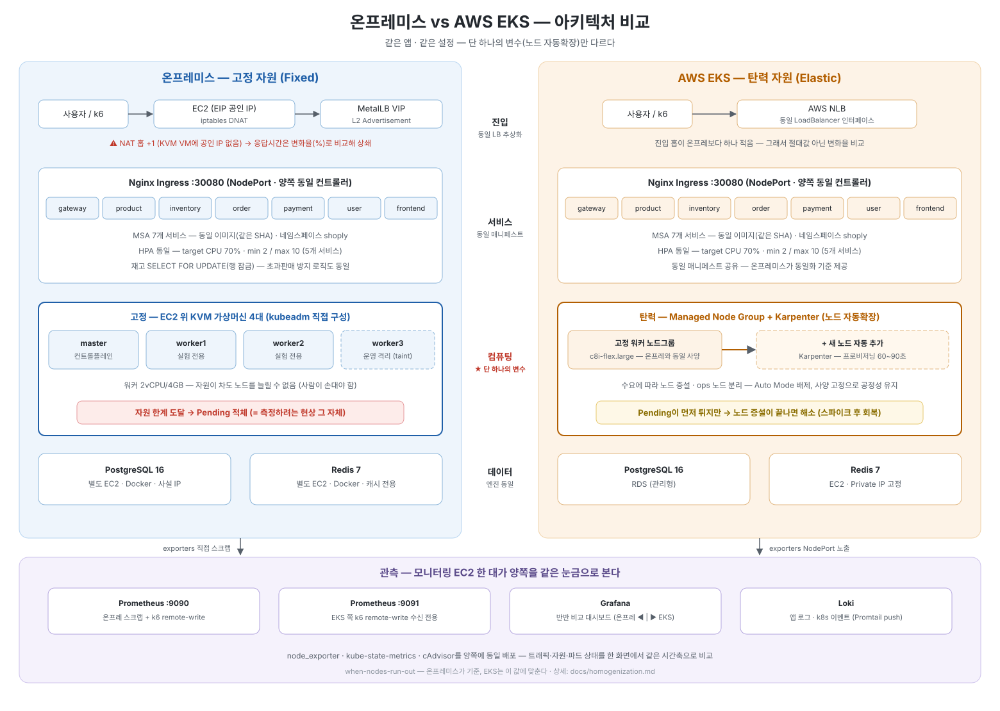

# 환경 동일화 — 온프레미스 ↔ EKS

두 환경을 공정하게 비교하려면 무엇을 똑같이 맞추고(통제변수) 무엇을 의도적으로 다르게 둘지(독립변수)를 못박아야 합니다.

**온프레미스가 기준입니다.** EKS는 이 값에 맞춥니다.

> 한 줄 원칙: **딱 하나 "노드 자동확장"만 다르게 두고, 나머지는 전부 같게.**


> 진입(MetalLB ↔ NLB)·트래픽 흐름(Nginx Ingress → MSA 파드)·컴퓨팅(고정 vs 탄력)·데이터/관측성 계층까지 양쪽을 나란히 놓고 비교한 다이어그램.

## A. 완전 동일하게 (통제변수)

| 항목 | 값 |
|---|---|
| 앱 이미지 | 같은 태그로 온프레·EKS 동일 빌드(GHCR) |
| 네임스페이스 | `shoply` (양쪽 동일) |
| **HPA 설정값** | **target CPU 70%, minReplicas 2, maxReplicas 99**(5개 서비스: gateway/product/inventory/order/payment) — 세 값 모두 양쪽 동일 |
| resource requests/limits | request 100m / limit 500m(frontend 50m/200m), 서비스별 동일값 |
| K8s 마이너 버전 | 1.34 |
| 진입 | ingress-nginx(양쪽 동일 컨트롤러·라우팅), **ALB는 안 씀** — LB 종류가 다르면 트래픽 경로·응답시간이 오염되므로 통제변수로 고정 |
| 모니터링 컴포넌트 | node_exporter · kube-state-metrics · cAdvisor · promtail(양쪽 동일 배포) |
| DB/Redis 엔진 | PostgreSQL 16 / Redis 7 동일 버전, `max_connections=300`, 앱 pool max 8(서비스당) |

> HPA는 처음엔 max 10으로 두었으나, 파드가 상한에 막혀 노드 한계(Pending)까지 도달하는 데 시간이 오래 걸려 **양쪽 모두 max 99로 변경**했습니다 — 파드 수는 HPA가 아니라 노드 자원이 제한하도록 해서, "노드 자동확장"의 차이가 드러나게 하기 위함입니다. 온프레 vs EKS 비교 실험(실행 ②)은 이 값으로 진행했습니다.

## B. 비슷하게 (완전 일치는 불가능, 최대한 근접)

| 항목 | 온프레미스 | EKS |
|---|---|---|
| CNI | Flannel | AWS VPC CNI(aws-node) — 구현은 다르나 둘 다 L3 파드망, 측정 대상 아님 |
| 노드 스펙 | 실험 워커: KVM VM 2vCPU/4GB (호스트 c8i.2xlarge) | 실험 노드(api·service): **c8i-flex.large** 2vCPU/4GB · ops 노드: t3.medium (비용 절감) |
| OS | Ubuntu 24.04 | EKS 최적화 AMI(Ubuntu 24.04.4) |
| 컨테이너 런타임 | containerd 2.x | containerd 2.2.1 |

> 실험 워커 1노드 = 2vCPU/4GB, 같은 c8i 계열로 양쪽 동일 — 이게 "고정 자원의 한계 vs 탄력 자원" 비교의 전제입니다. 측정에 쓰지 않는 ops 노드(모니터링·ingress 등)는 비용 때문에 EKS에서 t3.medium으로 두었습니다.

## C. 의도적으로 다르게 두는 것 (독립변수)

| 항목 | 온프레미스 | EKS | 이유 |
|---|---|---|---|
| **노드 자동확장** ★ | 고정 워커(안 늘어남) | Karpenter(노드 자동 추가) | **유일한 핵심 변수** |
| 컨트롤플레인 | kubeadm 직접 운영 | AWS 관리형 | EKS 본질, 측정 안 함 |
| 진입 경로 | EC2 iptables DNAT → MetalLB VIP (1홉 추가) | 워커 공인 IP 직접 | KVM VM에 공인 IP가 없어 불가피 — 응답시간은 절대값이 아니라 **변화율(%)**로 비교해 상쇄 |

## 트래픽 진입 경로 차이

```
[온프레미스]
  사용자 → EC2 공인IP:80/443
            └ iptables DNAT (EC2:80/443 → MetalLB VIP)        ← 홉 1개 더
              └ Nginx Ingress(worker3) → 서비스 파드

[EKS]
  사용자 → Worker 공인IP:30080                                ← VM 홉 없음
            └ Nginx Ingress(NodePort 30080) → 서비스 파드
```

## 노드별 서비스 초기 배치 (soft nodeAffinity, 양쪽 동일 라벨링)

| 노드 | 초기 배치 서비스 |
|---|---|
| worker1 | gateway, product, inventory |
| worker2 | frontend, order, payment, user |

soft(=preferred)라서 노드가 죽으면 다른 노드로 재배치될 수 있습니다 — 노드 장애 실험(worker1 종료, 설계만 하고 미실행)에서 전부 worker2로 몰려 Pending이 발생하는 걸 관찰하려던 목적입니다.

## 포트 (양쪽 동일하게 통일)

| 대상 | 포트 | 온프레미스 경로 | EKS 경로 |
|---|:---:|---|---|
| K8s 인그레스 | 80/443 (온프레) · 30080 (EKS) | EC2 iptables DNAT → MetalLB VIP | Worker 공인IP:NodePort 직접 |
| 앱 메트릭 | 30400~30404 | iptables DNAT → Prometheus | Worker 공인IP:NodePort |
| kube-state-metrics | 30800 | iptables DNAT | Worker 공인IP:NodePort |
| node_exporter | 9100 / 39101~39103 | iptables DNAT | Worker 공인IP |
| PostgreSQL | 5432 | EC2 사설IP | RDS 엔드포인트(VPC 내부) |
| Redis | 6379 | EC2 사설IP | Redis EC2 공인IP |

핵심 차이는 **"iptables DNAT + MetalLB VIP(온프레) vs 공인 IP 직접(EKS)"** 한 줄이고, 메트릭 수집용 포트 번호는 양쪽 동일하게 통일했습니다.

## 동일화 검증 명령 (EKS 구축 후)

```bash
kubectl version
kubectl get nodes -o wide                    # 워커 2vCPU/4GB 확인

kubectl get deploy -n shoply \
  -o custom-columns='NAME:.metadata.name,CPU_REQ:.spec.template.spec.containers[0].resources.requests.cpu'
kubectl get hpa -n shoply                    # target 70 / min 2 / max 99

kubectl get svc -n ingress-nginx             # NodePort 30080 확인
psql -h <RDS-엔드포인트> -U shoply -c "SHOW max_connections;"   # 300
```

위 값들이 온프레미스와 일치하면 "노드 확장만 다른 공정한 비교 조건"이 확보된 것입니다.
